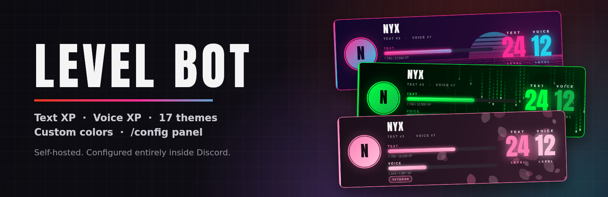
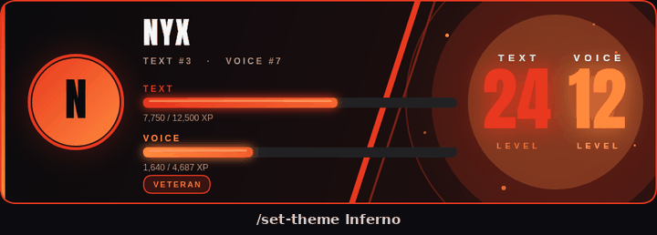
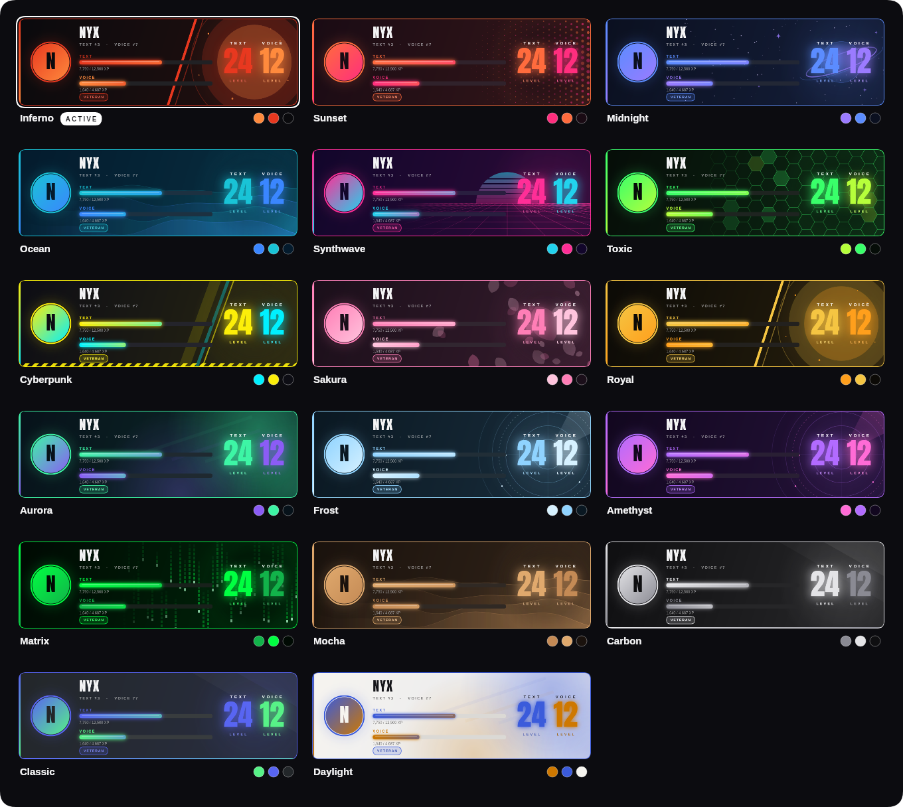
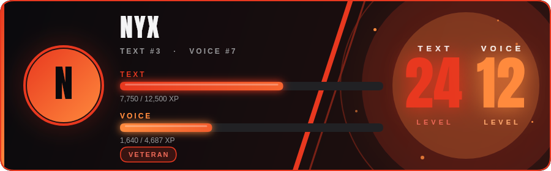
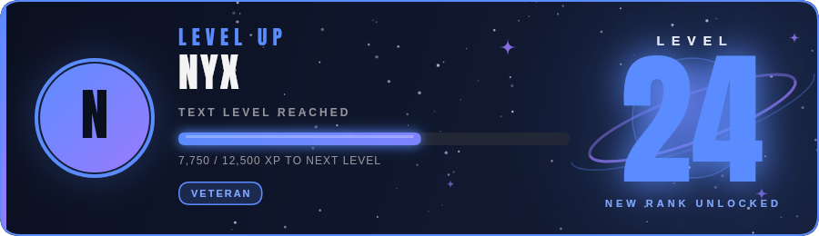
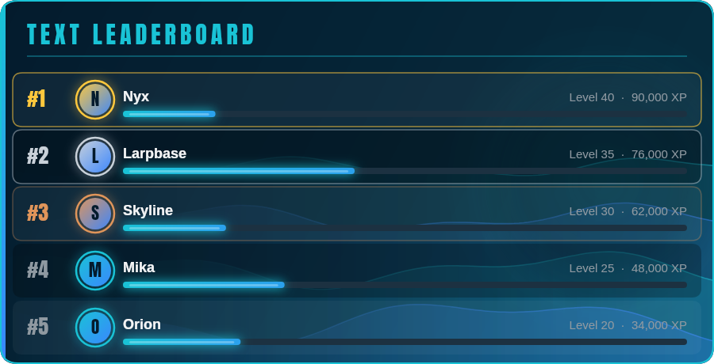
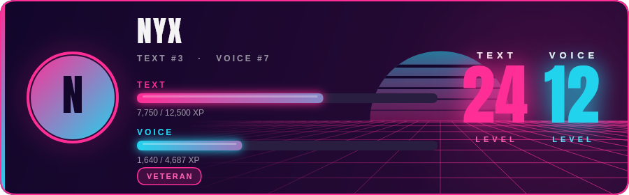
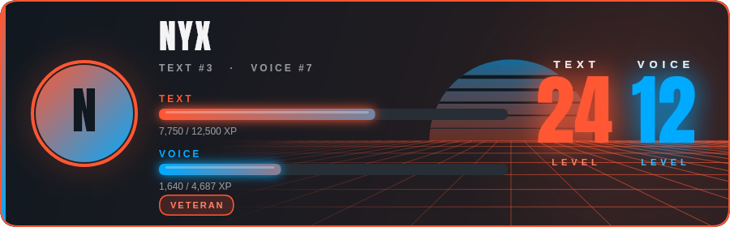

<div align="center">



<br>

[](https://github.com/Just9OO/900LVLBot/actions/workflows/ci.yml)
[](https://github.com/Just9OO/900LVLBot/releases)
[](https://github.com/Just9OO/900LVLBot/commits)
[](https://github.com/Just9OO/900LVLBot/stargazers)
[](https://nodejs.org)
[](https://discord.js.org)
[](https://www.sqlite.org)
[](#license)

**A self-hosted Discord levelling bot.** It tracks chat and voice activity separately, draws rank cards in 17 themes (or your own colors), hands out roles as people level up, and is configured entirely from inside Discord.<br>
Your server, your data, your look.

[**Themes**](#themes) · [**Control panel**](#the-control-panel) · [**Commands**](#commands) · [**Setup**](#setup) · [**How XP works**](#how-xp-works) · [**Troubleshooting**](#troubleshooting)

</div>

---

<div align="center">

### Every theme, one command: `/theme`



<br>



</div>

---

## At a glance

<table>
<tr>
<td width="50%" valign="top">

### 🎨 Look
- **17 themes** with unique background artwork
- **Custom themes** from just three colors
- Level, level-up and leaderboard cards all match
- Auto-contrast keeps every palette readable

</td>
<td width="50%" valign="top">

### 🎛️ Control
- **`/config` panel**: menus, buttons and forms
- Custom level-up messages with placeholders
- Card, embed, plain-text or silent level-ups
- Per-server XP rates, cooldown and filters

</td>
</tr>
<tr>
<td width="50%" valign="top">

### 📈 Progression
- **Separate text and voice** XP, levels and ranks
- Activity roles at milestones (stack or single)
- Timed **XP boost** events
- Image leaderboards with avatars and medals

</td>
<td width="50%" valign="top">

### 🛡️ Reliable
- Admin commands hidden from members
- Announcements can never ping `@everyone`
- One SQLite file, automatic upgrades
- Tested: `npm test` renders every theme

</td>
</tr>
</table>

<div align="center">

 
<br>
 

</div>

---

## Themes

Browse them live with **`/theme`**: a gallery with previews you can flip through, and (for admins) an **Apply** button. Or apply one directly with **`/set-theme`** — it autocompletes as you type.

| | Theme | Vibe | Background |
|---|---|---|---|
| 🔥 | **Inferno** | Black and blazing red. The classic. | Sun |
| 🌇 | **Sunset** | Hot orange melting into magenta. | Halftone |
| 🌌 | **Midnight** | Deep navy sky, electric blue stars. | Stars |
| 🌊 | **Ocean** | Cool teal tides. | Waves |
| 🌆 | **Synthwave** | 80s neon grid and a cyan glow. | Grid |
| ☢️ | **Toxic** | Radioactive green honeycomb. | Hex |
| 🤖 | **Cyberpunk** | Hazard yellow with cyan accents. | Stripes |
| 🌸 | **Sakura** | Soft pink petals on dark plum. | Petals |
| 👑 | **Royal** | Black and gold, for the elite. | Sun |
| 🌠 | **Aurora** | Northern lights in mint and violet. | Aurora |
| ❄️ | **Frost** | Icy blue radar rings. | Rings |
| 🔮 | **Amethyst** | Rich purple with a pink flare. | Rings |
| 🟩 | **Matrix** | Falling green code. | Code rain |
| ☕ | **Mocha** | Warm coffee and cream. | Waves |
| ⚫ | **Carbon** | Understated monochrome. | Minimal |
| 💙 | **Classic** | Familiar blurple on charcoal. | Minimal |
| ☀️ | **Daylight** | A light theme for the bright side. | Aurora |

### Make your own

Don't like any of them? Run **`/custom-theme`** and choose three colors:

| Color | What it paints |
|---|---|
| **Background** | The card itself. Light *or* dark both work |
| **Primary** | Borders, avatar ring, **text** XP bar and level number |
| **Secondary** | **Voice** XP bar and level number, plus highlights |

```
/custom-theme background:#101820 primary:#FF5733 secondary:#00AAFF style:Grid name:Mine
```

<div align="center">

</div>

Or run `/custom-theme` with no options to open the **editor**: start from any preset, edit the colors in a form, swap the background style from a menu, or hit 🎲 **Surprise me** for a random palette. Every change shows a live preview.

You never have to worry about unreadable cards: text color is chosen automatically for your background, and if your primary or secondary color would blend into it, the bot lightens or darkens it until it doesn't. Hex codes can be written `#FF5733`, `FF5733` or `#F53`.

**Background styles:** Sun · Grid · Waves · Stars · Hex · Aurora · Stripes · Halftone · Code rain · Petals · Rings · Minimal

Want to try colors without touching Discord? `npm run previews -- --custom "#101820,#FF5733,#00AAFF,grid"` renders one to `previews/custom.png`.

---

## The control panel

**`/config`** opens a private panel only you can see. Use the menu at the top to move between sections; every change is saved the moment you make it.

| Section | What you can do |
|---|---|
| 🏠 **Overview** | Everything at a glance |
| ⚡ **XP & Rates** | Multiplier, text XP range, voice XP, message cooldown (5–600 s), role stacking on/off, reset to defaults |
| 📣 **Level-up Messages** | Pick the channel from a menu, choose card / embed / text / off, write your own message with a live preview |
| 🎨 **Appearance** | Switch themes with a preview, open the gallery, open the custom theme editor |
| 🚫 **Filters** | Choose channels and roles that don't earn XP |

### Level-up messages

Write the message in the panel using these placeholders:

| Placeholder | Becomes |
|---|---|
| `{user}` | A mention of the member |
| `{username}` | Their name, without a ping |
| `{level}` | The level they reached |
| `{type}` | 💬 Text or 🎙️ Voice |
| `{role}` | The role they just earned (blank if none) |
| `{server}` | Your server's name |

```
🎉 {user} just reached **{type} level {level}** in {server}!
```

If a level-up also awards a role and your message doesn't mention `{role}`, the bot adds a line about it. Mentions in announcements are locked down: only the member who levelled up is ever pinged.

---

## Commands

### Everyone

| Command | What it does |
|---|---|
| `/level [user]` | Rank card with text and voice XP, levels, server ranks and role badge |
| `/leaderboard [type]` | Top 10 as an image, with Text / Voice buttons to flip between them |
| `/stats` | Server totals plus a text and voice podium |
| `/theme` | Browse every card theme with live previews |
| `/help` | Interactive help. Admins see every section, members just theirs |

### Admin: setup and appearance

| Command | What it does |
|---|---|
| `/config` | **The control panel** (XP, level-ups, appearance, filters) |
| `/set-theme <theme>` | Apply a preset, or your custom theme |
| `/custom-theme [background] [primary] [secondary] [style] [name]` | Create or edit your custom theme; no options opens the editor |
| `/set-channel [channel]` | Where level-ups are announced (omit to post where they happen) |
| `/set-xp-rate` | View or change multiplier, text range and voice XP |
| `/ignore-channel <channel>` | Toggle XP in a channel |
| `/no-xp-role <role>` | Toggle XP for a role |

### Admin: roles and XP

| Command | What it does |
|---|---|
| `/setup-roles [type] [mode]` | Create the default level roles |
| `/manage-roles set <level> <role> [type]` | Map any existing role to a level |
| `/manage-roles rename <level> <name> [type]` | Rename a level role (renames the Discord role too) |
| `/manage-roles remove <level> [type]` | Remove a milestone |
| `/manage-roles list` | Show every configured milestone |
| `/sync-roles` | Rebuild everyone's roles from their saved level |
| `/xp-boost start <duration> [multiplier] [label]` | Start a timed boost event, e.g. `2h` |
| `/xp-boost stop` · `/xp-boost status` | Cancel it, or see what's running |
| `/set-xp <user> <type> <level>` | Force a member's level (roles sync too) |
| `/reset-user <user> <type>` | Wipe text, voice or all XP for a member |

All admin commands are hidden from members by default. The `/config`, `/theme` and `/custom-theme` panels also check permissions again on every click, so only members with **Administrator** or **Manage Server** can change anything.

---

## Setup

### 1. Create the bot

1. Open the [Discord Developer Portal](https://discord.com/developers/applications) → **New Application**.
2. **Bot** tab → under **Privileged Gateway Intents** enable **Server Members Intent** and **Message Content Intent**. Neither is optional.
3. **Reset Token**, copy it, and keep it secret.
4. **General Information** → copy the **Application ID** (this is your `CLIENT_ID`).

### 2. Invite it

**OAuth2 → URL Generator**, scopes `bot` and `applications.commands`, with these permissions:

| Permission | Why |
|---|---|
| View Channels, Send Messages | Post level-ups |
| Embed Links, Attach Files | Cards and embeds |
| Read Message History | Normal operation |
| Manage Roles | Hand out activity roles |
| Connect | See who is in voice |

### 3. Install and run

```bash
git clone https://github.com/Just9OO/900LVLBot.git
cd 900LVLBot
npm install
cp .env.example .env     # then fill it in
npm start
```

Node.js **20 or newer** is required (`node --version`).

### 4. Environment variables

| Variable | Required | Description |
|---|---|---|
| `DISCORD_TOKEN` | ✅ | Your bot token |
| `CLIENT_ID` | ✅ | Your application ID |
| `GUILD_ID` | | Your server's ID while testing: commands appear instantly. Leave empty in production (global commands can take up to an hour) |
| `DB_PATH` | | Database location. Default `./data/bot.db`. Use a persistent volume when hosting |

> ⚠️ **Never commit `.env` or share your token.** If it ever leaks, reset it in the Developer Portal straight away. `.env` is already in `.gitignore`.

Slash commands register themselves on startup, so no separate deploy step is needed.

### 5. First-time server setup

```
/setup-roles both        create the default level roles
/config                  set the level-up channel, XP rates and theme
```

That's it. Everything else is optional.

---

## Activity roles

`/setup-roles` creates this default set:

| Level | Text role | Voice role |
|---|---|---|
| 5 | 📝 Newcomer | 🎧 Listener |
| 10 | 💬 Chatter | 🎙️ Talker |
| 20 | 🗣️ Regular | 📻 Regular |
| 35 | ⭐ Veteran | 🔊 Veteran |
| 50 | 🔥 Elite | 🎵 Elite |
| 75 | 💎 Legend | 👑 Voice King |

Rename any of them with `/manage-roles rename`, or point a level at a role you already have with `/manage-roles set`. The bot never touches roles it doesn't manage.

**Stack vs single.** In *stack* mode a member at level 35 keeps Newcomer, Chatter, Regular and Veteran. In *single* mode they only hold Veteran. Toggle it under `/config` → **XP & Rates**, then run `/sync-roles` to apply it to existing members.

**The bot's role must sit above the level roles** in Server Settings → Roles, or Discord won't let it assign them.

---

## How XP works

| | Default | Change it in |
|---|---|---|
| **Text XP** | 15–25 XP per message (random) | `/config` → XP & Rates |
| **Cooldown** | 60 s between rewarded messages, messages under 5 characters don't count | `/config` → XP & Rates |
| **Voice XP** | 10 XP per minute while not muted or deafened | `/config` → XP & Rates |
| **Multiplier** | 1.0× | `/config` → XP & Rates |
| **XP boost** | Temporarily replaces the multiplier | `/xp-boost` |

If the bot restarts while people are in voice, it picks them up straight away.

**The level curve** is `floor(100 × (level + 1)^1.5)` XP for each level:

| Level | XP for that level | Total XP to reach it |
|---|---|---|
| 1 | 100 | 100 |
| 5 | 1,118 | 2,819 |
| 10 | 3,162 | 14,264 |
| 25 | 12,500 | 131,300 |
| 50 | 35,355 | 724,849 |
| 75 | 64,951 | 1,981,105 |
| 100 | 100,000 | 4,050,079 |

---

## Upgrading from v1

Just replace the files and start the bot. The database upgrades itself on first launch and nothing is lost.

- Servers that had customised card colors with `/set-card-color` get an **equivalent custom theme** automatically (named *Migrated*), so their cards look the same.
- **`/set-card-color` is gone**: `/custom-theme` and `/config` replace it.
- `/leaderboard` no longer has a *duration* option. It always showed all-time rankings, so the choice was misleading.
- `package.json` now lists `better-sqlite3`, which is what the code uses. (An older copy listed `sqlite3` and `sqlite`, which breaks `npm install` + `npm start`.)
- New in the database: theme, custom colors, cooldown, and level-up mode and message. All additive.

---

## Hosting

### One-click deploy

[](https://render.com/deploy?repo=https://github.com/Just9OO/900LVLBot)

`render.yaml` sets up a background worker with a 1 GB disk at `/data` and `DB_PATH` already pointed at it. You only paste `DISCORD_TOKEN`, `CLIENT_ID` and (optionally) `GUILD_ID`. Render workers and disks are paid, so check the price before confirming.

**Railway.** `railway.json` is included. Create a project from the repo, add the three variables, attach a volume mounted at `/data` and set `DB_PATH=/data/bot.db`. Volumes and variables can only be set in the Railway dashboard.

### Other hosts

**Any container host.** Connect the repo, add `DISCORD_TOKEN` and `CLIENT_ID` as variables, and use `npm start` (on Render choose *Background Worker*). Mount a persistent disk and point `DB_PATH` at it (for example `/data/bot.db`), or the database resets on every deploy.

**VPS**

```bash
curl -fsSL https://deb.nodesource.com/setup_20.x | sudo -E bash -
sudo apt install -y nodejs
git clone https://github.com/Just9OO/900LVLBot.git && cd 900LVLBot
npm install && cp .env.example .env && nano .env

npm install -g pm2
pm2 start src/index.js --name 900lvlbot
pm2 save && pm2 startup     # run the command it prints
```

**Optional: Montserrat font.** The cards fall back to system fonts. For the intended look, download [Montserrat](https://fonts.google.com/specimen/Montserrat) and put `Montserrat-Bold.ttf` and `Montserrat-Regular.ttf` in `assets/fonts/`, then restart.

---

## Development

```bash
npm test             # unit tests: theme maths, XP curve, every theme rendering every card
npm run previews     # render all themes to ./previews, no Discord needed
npm run dev          # restart on file changes (nodemon)
```

<details>
<summary><b>Project structure</b></summary>

```
900LVLBot/
├── src/
│   ├── index.js                  entry point: loads commands and events, deploys, logs in
│   ├── commands/
│   │   ├── config.js             /config control panel
│   │   ├── theme.js              /theme gallery
│   │   ├── setTheme.js           /set-theme
│   │   ├── customTheme.js        /custom-theme and its editor
│   │   ├── level.js              /level
│   │   ├── leaderboard.js        /leaderboard
│   │   ├── stats.js              /stats
│   │   ├── help.js               /help
│   │   ├── setupRoles.js · manageRoles.js · syncRoles.js
│   │   ├── xpBoost.js · setXp.js · resetUser.js
│   │   └── setChannel.js · setXpRate.js · ignoreChannel.js · noXpRole.js
│   ├── events/
│   │   ├── interactionCreate.js  routes commands, buttons, menus, modals and autocomplete
│   │   ├── messageCreate.js      text XP
│   │   ├── voiceStateUpdate.js   voice tracking and XP ticker
│   │   └── ready.js              picks up members already in voice
│   ├── database/db.js            SQLite, queries, cache, migrations
│   └── utils/
│       ├── themes.js             theme engine: presets, custom themes, color maths
│       ├── cardRenderer.js       all card artwork and rendering
│       ├── themeUi.js            gallery and editor messages
│       ├── levelUp.js            level-up announcements
│       ├── ui.js                 shared embed and permission helpers
│       ├── xpMath.js             XP curve
│       └── roleManager.js · deployCommands.js
├── .github/                      CI workflow, issue and PR templates
├── render.yaml · railway.json    deploy configs
├── CONTRIBUTING.md · LICENSE
├── test/                         node:test suites
├── scripts/render-previews.js    theme previews without Discord
├── docs/                         README images
├── assets/fonts/                 Anton included, Montserrat optional
└── .env.example
```

</details>

**Interactions** use a `command:action:args` custom ID convention: the first segment picks the command, which handles the rest in its own `component()` or `modal()` function, so adding a panel to a command never touches the router.

**Adding a theme.** Add one line to `PRESET_DEFS` in `src/utils/themes.js` (`id`, `name`, `emoji`, `description`, three colors, `style`) and it appears everywhere: gallery, `/set-theme`, `/config`, and the tests. Keep it to 24 presets or fewer so it fits Discord's 25-option menus (one slot is reserved for a custom theme). **Adding a background style** means one painter function in `cardRenderer.js` and one entry in `STYLES`.

---

## Troubleshooting

**Slash commands don't appear.** Global commands can take up to an hour. Set `GUILD_ID` for instant updates while testing.

**The bot is online but ignores messages.** Message Content Intent is off. Enable it in the Developer Portal → Bot → Privileged Gateway Intents.

**Level-ups aren't showing.** Check `/config` → **Level-up Messages**: the style must not be *Off*, and the bot needs Send Messages and Attach Files in that channel. With no channel set, text level-ups appear in the channel where they happened and voice level-ups go by DM.

**Roles aren't assigned.** The bot needs **Manage Roles** and its role must be above the level roles. Also check `/manage-roles list` that milestones exist.

**Cards show boxes instead of emoji.** Card images can only draw characters the host's fonts contain. Role badges have emoji stripped automatically, but a custom name could still contain unusual symbols.

**`npm install` fails on `@napi-rs/canvas`.** On older Linux distros try:
```bash
sudo apt install -y libcairo2-dev libpango1.0-dev libjpeg-dev libgif-dev librsvg2-dev
```

**`Cannot find module 'better-sqlite3'`.** Run `npm install` again with the `package.json` from this version. It needs a build toolchain on unusual platforms (`build-essential python3`).

**A button says "That control has expired".** The command it belonged to changed or was removed. Run the command again.

---

## Contributing

Bug reports, theme ideas and PRs are welcome. [CONTRIBUTING.md](CONTRIBUTING.md) covers setup, tests and how to add a theme. Never paste your bot token in an issue.

---

## License

MIT. Use it, fork it, change it. Please keep the license notice if you redistribute it.
